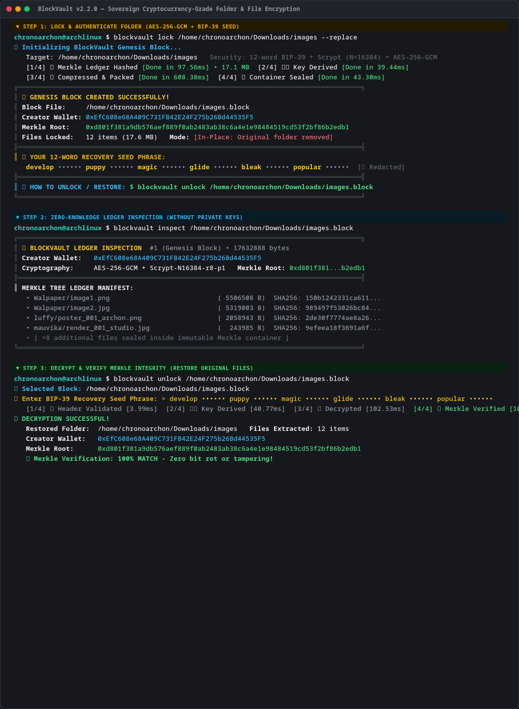
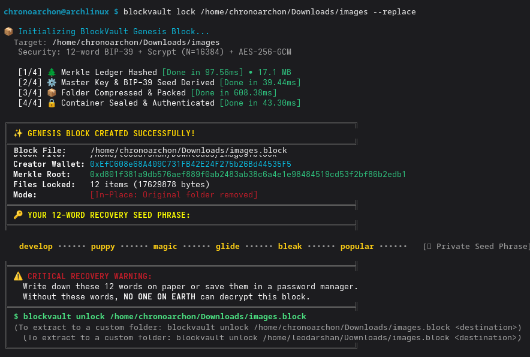
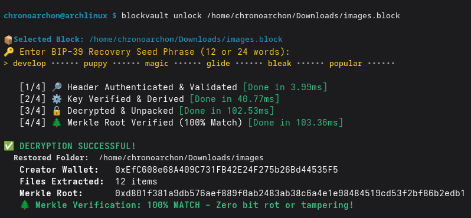
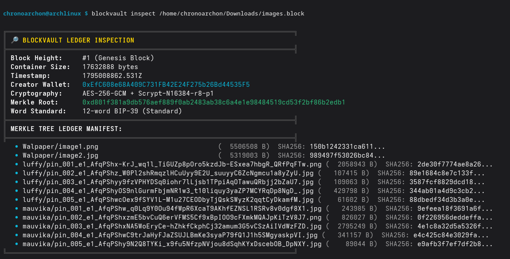

# BlockVault

[](https://opensource.org/licenses/MIT)
[](https://www.rust-lang.org)
[](https://github.com/chronoarchon/blockvault)
[](https://github.com/chronoarchon/blockvault)
[](https://github.com/chronoarchon/blockvault/releases)

A sovereign, cryptocurrency-grade folder and file encryption engine and CLI written in Rust.

BlockVault secures local directories and individual files using the same cryptographic primitives that protect decentralized blockchain networks: BIP-39 mnemonic seeds, Scrypt key derivation, AES-256-GCM authenticated encryption, and domain-separated Merkle trees.

<p align="center">
  
</p>

---

## Cryptographic Architecture

- **BIP-39 Mnemonic Seed Phrases:** Generates 12-word (128-bit) or 24-word (256-bit) recovery seed phrases using the official 2,048-word BIP-39 dictionary.
- **BIP-39 Optional Passphrase:** Supports the "13th/25th word" feature for plausible deniability and multi-factor defense.
- **Scrypt Key Derivation:** Employs Ethereum-standard memory-hard Scrypt parameters (`N=16384, r=8, p=1`) to prevent GPU and ASIC cracking attacks.
- **AES-256-GCM Authenticated Encryption:** Uses Galois/Counter Mode with a 128-bit authentication tag and Additional Authenticated Data (AAD) to ensure privacy and tamper detection.
- **Zeroize Memory Hardening:** Securely wipes encryption keys, seeds, and plaintext buffers from RAM on drop to thwart cold-boot and memory dump attacks.
- **Domain-Separated Merkle Trees:** Recursively hashes files via SHA-256 (`0x00` leaf prefix, `0x01` branch prefix, per RFC 6962) to produce an immutable root hash for bit-level integrity verification.
- **EIP-55 Wallet Identity:** Derives a checksummed Ethereum-style creator address from each seed.

---

## Installation

### Linux & macOS (One-Line Installer)

Automatically builds and installs the standalone binary into `~/.local/bin`:

```bash
curl -fsSL https://raw.githubusercontent.com/chronoarchon/blockvault/main/install.sh | bash
```

### Windows (PowerShell & Command Prompt)

Install directly via the one-line native installer (zero dependencies, instant setup):

```powershell
# PowerShell (Recommended)
irm https://raw.githubusercontent.com/chronoarchon/blockvault/main/install.ps1 | iex
```

Or from Command Prompt (`cmd.exe`):
```cmd
curl -fsSL https://raw.githubusercontent.com/chronoarchon/blockvault/main/install.cmd -o install.cmd && install.cmd
```

Or build from source via Cargo:
```powershell
cargo install --git https://github.com/chronoarchon/blockvault.git
```

### Build from Source (All Platforms)

```bash
git clone https://github.com/chronoarchon/blockvault.git
cd blockvault
cargo build --release
cp target/release/blockvault ~/.local/bin/
```

---

## Instructions & Usage Examples

### 1. Locking a Folder or File

<p align="center">
  
</p>

#### Example A: Standard 12-Word Lock
Encrypts `~/Downloads/documents` into `~/Downloads/documents.block` and outputs your 12-word recovery seed phrase:

```bash
blockvault lock ~/Downloads/documents
```

#### Example B: Enterprise 24-Word Security with Passphrase
Generates a 256-bit 24-word seed and applies an optional passphrase (the 25th word protection):

```bash
blockvault lock ~/Projects/secret-app --words 24 --passphrase "MyPassphrase#2026"
```

#### Example C: In-Place Locker Mode (`--replace`)
Encrypts the target directory and securely deletes the unencrypted source folder upon completion:

```bash
blockvault lock ~/Documents/private-vault --replace
```

#### Example D: Custom Output Destination
Specify an exact path for the output `.block` container:

```bash
blockvault lock ~/Downloads/data /backup/archives/data-2026.block
```

---

### 2. Unlocking a Block Container

<p align="center">
  
</p>

#### Example A: Interactive Unlock (Recommended)
Prompts securely in your terminal for your 12 or 24-word seed phrase:

```bash
blockvault unlock ~/Downloads/documents.block
```

#### Example B: Unlocking into a Specific Destination Folder
Restores the decrypted folder directly into a custom directory (e.g., `~/Restored`):

```bash
blockvault unlock ~/Downloads/documents.block ~/Restored
```

#### Example C: Unlocking with Optional Passphrase
If you locked the block with a passphrase, provide it via `-p` or `--passphrase`:

```bash
blockvault unlock ~/Projects/secret-app.block ~/Restored -p "MyPassphrase#2026"
```

#### Example D: Non-Interactive / Scriptable Unlock (`--phrase`)
Pass the recovery seed phrase directly for automated scripts or CI pipelines:

```bash
blockvault unlock data.block ~/Restored --phrase "word1 word2 word3 ... word12"
```

#### Example E: In-Place Extraction (`--replace`)
Extracts the files and deletes the `.block` container file upon successful cryptographic verification:

```bash
blockvault unlock ~/Downloads/documents.block --replace
```

---

### 3. Inspecting a Block Ledger (Public Header)

<p align="center">
  
</p>

BlockVault stores an unencrypted public manifest header containing the creator wallet, Merkle root, file inventory, and cryptographic parameters. Anyone can audit file integrity without knowing the encryption key:

```bash
blockvault inspect ~/Downloads/documents.block
```

Output:
```text
╔════════════════════════════════════════════════════════════════════════╗
║ 🔎 BLOCKVAULT LEDGER INSPECTION
╠════════════════════════════════════════════════════════════════════════╣
║ Block Height:     #1 (Genesis Block)
║ Container Size:   2100 bytes
║ Creator Wallet:   0xFCbd814d3B5a3186A0a3be96C93ae0e0f37288bB
║ Cryptography:     AES-256-GCM + Scrypt-N16384-r8-p1
║ Merkle Root:      0xb5e06c7d4e1113e7db61421ca5bb17d34d665a5a4cd4c0d8c393ba8bbe998c84
║ Word Standard:    12-word BIP-39 (Standard)
╠════════════════════════════════════════════════════════════════════════╣
║ MERKLE TREE LEDGER MANIFEST:
╠════════════════════════════════════════════════════════════════════════╣
   • invoice.pdf                                      (     2421 B)  SHA256: d1b1cba0...
   • backup.sql                                       (     2453 B)  SHA256: 57b26344...
╚════════════════════════════════════════════════════════════════════════╝
```

---

## 10-Stage QA & Cryptographic Verification Suite

BlockVault includes a 10-stage automated test suite that validates every cryptographic primitive, security boundary, and cross-platform edge case:

| Stage | Verification Focus | Status |
|:---:|---|:---:|
| **Stage 1** | BIP-39 12/24-word generation, wordlist dictionary, and checksum validation | **PASSED** |
| **Stage 2** | Passphrase entropy isolation (13th & 25th word deriving distinct keys) | **PASSED** |
| **Stage 3** | Memory-hard Scrypt KDF ($N=16384, r=8, p=1$) and 1-bit salt avalanche effect | **PASSED** |
| **Stage 4** | AES-256-GCM authenticated encryption, AAD integrity, and tag verification | **PASSED** |
| **Stage 5** | RFC 6962 Merkle tree determinism, cross-platform POSIX path normalization | **PASSED** |
| **Stage 6** | End-to-end folder packing, public header inspection, and extraction | **PASSED** |
| **Stage 7** | Complex multi-megabyte binary payloads, deep directory trees, and Unicode names | **PASSED** |
| **Stage 8** | Tampered container bit-flip detection & wrong mnemonic phrase rejection | **PASSED** |
| **Stage 9** | In-place locker mode (`--replace`) safe source deletion and cleanup | **PASSED** |
| **Stage 10** | Cross-platform path resolution, tilde expansion, and typo recovery | **PASSED** |

### Run the QA Test Suite Locally:

```bash
cargo test
```

---

## License

MIT License. Copyright (c) 2026 chronoarchon.
